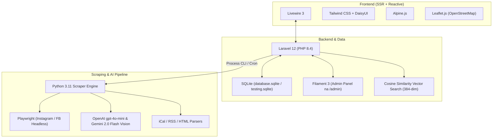
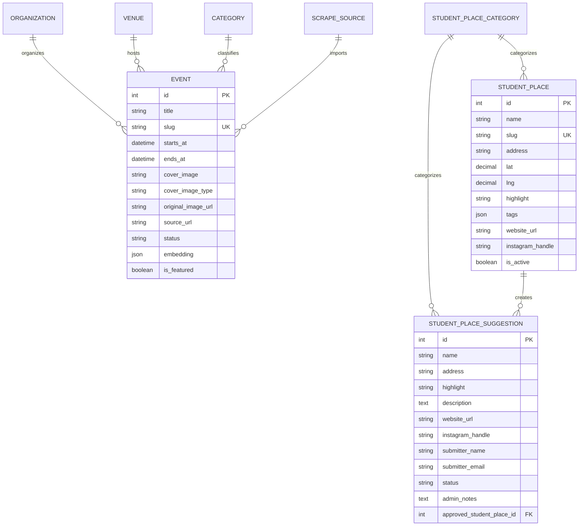

# BrnoAkce – Architektura, Pravidla & Příručka pro Agenty

> Tento dokument slouží jako **Single Source of Truth** pro architekturu, technologie, právní mantinely, UX pravidla a standardy vývoje platformy **BrnoAkce (Studentské akce Brno)**.
> Každý budoucí vývojář i AI agent **musí** před zahájením práce respektovat zde popsaná pravidla.

---

## 1. Vize a Cíl Projektu

**BrnoAkce** je centralizovaná, moderní a otevřená platforma pro brněnský studentský život. Agreguje a zpřehledňuje akce ze všech brněnských univerzit (**MUNI**, **VUT**, **MENDELU**, **UNOB**, **VETUNI**), studentských spolků a klubů na jednom místě:
* **Žádný studentský chaos:** Konec hledání akcí roztroušených na desítkách Instagramů, Facebooků a fakultních vývěsek.
* **Čisté, rychlé a moderní UI:** Žádný balast, žádné vyskakující reklamy, bleskové vyhledávání a interaktivní mapa.
* **Respekt k soukromí:** Žádné invazivní trackery (Google Analytics apod.), plně cookieless anonymní statistiky.
* **Právní čistota:** Soulad s českým autorským zákonem (zpravodajská licence § 34) a GDPR.

---

## 2. Technologický Stack



| Vrstva | Technologie | Popis |
|---|---|---|
| **Backend Framework** | Laravel 12 (PHP 8.4) | Robustní backend, migrace, Eloquent ORM, Artisan příkazy. |
| **Frontend Reaktivita** | Livewire 3 + Alpine.js | Dynamický feed, live search, přepínání mapy bez reloadu stránky. |
| **Stylování & Témata** | Tailwind CSS + DaisyUI | Podpora témat (`events-light`, `events-dark`), rotace jedním tlačítkem. |
| **Mapy** | Leaflet.js 1.9.4 + OpenStreetMap | Interaktivní mapa pro akce i studentská místa (`/mista`). |
| **Databáze** | SQLite | `/root/brno-events/database/database.sqlite` (testovací: `testing.sqlite`). |
| **Vektorové hledání** | 384-dim embeddingy | Kosinová podobnost počítaná přímo v PHP pro rychlé sémantické hledání. |
| **Scraper Engine** | Python 3.11 ve venvu | `scrapers/.venv/` – Playwright, BeautifulSoup, iCalendar, Vision API. |
| **Admin Rozhraní** | Filament 3 | Správa akcí, zdrojů, moderace, studentských míst a analytických widgetů. |

---

## 3. Zlatá Pravidla pro Vývoj & UI/UX (Must Follow)

### 1. Minimalismus a zákaz duplicitních ovládacích prvků
* **Žádná redundantní tlačítka:** Pokud je hero obrázek akce klikací a má štítek „Plakát akce“, **nesmí** být vedle tlačítka „Sdílet“ v akční liště duplicitní tlačítko „Plakát akce“.
* **Žádné rušivé hover prvky:** Na obrázcích nepoužívat vyskakující pilulky typu „Zvětšit plakát“ při najetí myší. Uživatel ví, že na obrázek může kliknout.
* **Sjednocené názvosloví:** Každá propagační grafika nebo flyer akce se nazývá **„Plakát akce“** (nikdy nerozdělovat uživatele matoucími pojmy jako „Webový banner“ vs. „Plakát“).

### 2. Pravidla pro Lightbox / Media Viewer
* **Celoobrazovkový moderní lightbox:** Tmavé pozadí (`bg-black/90 backdrop-blur-md`).
* **Intuitivní zavírání:** Okno se **musí** zavřít při kliknutí / tapnutí **kamkoliv mimo samotný plakát** (na pozadí okolo, nad i pod ním) a stiskem klávesy `Escape`.
* **Žádné schované křížky:** V horní liště nad lightboxem **není** žádné rušivé tlačítko `✕`.
* **Žádné tlačítko „Stáhnout“:** Lightbox slouží k prohlížení a ověření informací, tlačítko stažení do modalu nepatří.
* **Vždy odkaz na „Původní zdroj“:** Každý lightbox má viditelné tlačítko s odkazem na původní zdroj s kaskádovým fallbackem (`original_image_url` &rarr; `source_url` &rarr; `instagram_post_url` &rarr; `facebook_event_url` &rarr; web organizace).

### 3. Zásady pro právní texty a autorský zákon
* **Čisté UI bez právního balastu:** Na veřejných stránkách (karta akce, detail události, feed) **nikdy nezobrazovat** právní formulace o zpravodajské licenci (§ 34 autorského zákona).
* **Vše patří do Podmínek použití:** Veškeré právní doložky o zpravodajské licenci, vyloučení odpovědnosti a postupu Notice & Takedown patří výhradně na stránku [`/podminky`](file:///root/brno-events/resources/views/pages/terms.blade.php).
* **Transparentní kontakt:** Každá akce obsahuje tlačítko nahlášení (`livewire:report-event-modal`), kde mohou spolky a autoři požádat o okamžité stažení či úpravu.

### 4. Cookieless Analytika & GDPR
* **Žádné ukládání IP adres:** Ukládá se pouze denní rotovaný hash (`sha256(ip + salt + date)`).
* **Detekce státu bez trackerů:** Stát se detekuje z hlaviček Cloudflare (`CF-IPCountry`) nebo `Accept-Language`.
* **Vyloučení interního provozu:**
  * Automatické testy (PHPUnit, Playwright) i přihlášení administrátoři mají `is_internal = true`.
  * Vývojář může svůj prohlížeč trvale vyloučit jedním kliknutím přes `/analytics/toggle-device` (cookie `brnoakce_internal=1` na 1 rok).

### 5. Zákaz spamu na Discord Webhook
* **Během testů a deploymentu:** Testovací prostředí (`APP_ENV=testing` nebo PHPUnit / Playwright) má `DISCORD_WEBHOOK_URL=""`, aby vývojářský a testovací proces nespamoval Discord kanál chybovými hlášeními.

---

## 4. Pravidla pro Scrapery a Zpracování Dat

### 1. Parsování datumu a českých dnů v týdnu
* Pokud je na plakátu nebo v popisku uveden pouze den v týdnu (např. *„STŘEDY 19:30“*, *„každou středu“*, *„ve čtvrtek“*):
  * **Musí se vypočítat nejbližší nadcházející konkrétní datum tohoto dne počínaje dneškem.**
  * V promptu pro AI Vision (OpenAI/Gemini) je výslovný příkaz a v Pythonu post-processing funkce `sanitize_extracted_event_date()`, která případnou chybu LLM (např. pondělí místo středy) automaticky opraví na správný den.
* **Odstranění emojis:** Z názvů i popisů akcí se pomocí `clean_emoji()` odstraňují emojis dle standardu projektu.

### 2. Rozdíl mezi Smazáním (Soft Delete) a Zamítnutím (Rejected)
* **Koš / Soft Delete (`deleted_at`):** Akce byla platná, ale zrušila se nebo byla stažena. Lze ji obnovit.
* **Zamítnuto (`status = 'rejected'`):** Akce byla irelevantní, spam nebo mimo Brno. Scraper se na tuto URL pamatuje a **nikdy** ji znovu nenaimportuje!

### 3. Klasifikace typů obrázků
1. **`poster`:** Poměr stran výška : šířka &gt; 1.15 (vertikální formát letáku / A4 plakátu).
2. **`banner`:** Šířka &gt;= 1.2 &times; výška (horizontální webový banner / Facebook cover).
3. **`article`:** Čtvercový nebo běžný článkový obrázek.
4. **`stock`:** Automatický kvalitní fotoplaceholder z Unsplash podle kategorie akce.

### 4. Moderace akcí: Sociální sítě (IG & FB) vs. Oficiální univerzitní zdroje
* **Oficiální weby, iCal kalendáře a RSS (MUNI, VUT, MENDELU atd.):** Jsou důvěryhodné, importují se rovnou se stavem `status = 'published'`.
* **Sociální sítě (Instagram posty, Facebook events):** Příspěvky ze sociálních sítí mohou obsahovat reels, memes, neúplné texty nebo změny programu. Proto se nově scrapnuté položky z IG/FB ukládají jako `status = 'pending_review'`.
* **Schvalovací workflow:** V administraci Filamentu (nebo autonomním AI agentem) se v záložce *„Ke schválení (moderace)“* akce zkontrolují a 1 kliknutím schválí (`published`) nebo zamítnou (`rejected`).

### 5. Retenční politika a archiv akcí (365 dní) & SEO
* **Délka uchování dat:** Server disponuje dostatečnou diskovou kapacitou (50 GB), akce se drží v databázi po dobu **minimálně 1 celého roku (365 dní)**.
* **SEO archiv proběhlých akcí:** Proběhlé akce (`starts_at < now()`) se nemažou ani nevedou na 404. Zůstávají zaindexovány ve vyhledávačích (`sitemap.xml`) s prioritou 0.5.
* **UX v detailu proběhlé akce:** Detail proběhlé akce obsahuje zřetelný žlutý informační alert: *„Tato akce již proběhla ([datum]). Informace slouží jako archiv.“* Akční tlačítka pro nákup vstupenek jsou přepnuta do archivního stylu, aby nemátla návštěvníky.

---

## 5. Crowdsourcing Studentských Míst (`/mista`)

Aby byla mapa studentských míst v Brně co nejaktuálnější a nejrozsáhlejší, platforma umožňuje studentům doporučovat vlastní ověřená místa:
1. **Frontend formulář:** Na `/mista` je k dispozici tlačítko *„Přidat místo“*, které otevírá moderní DaisyUI modal (`ProposeStudentPlaceModal`).
2. **Sběr parametrů:** Název, kategorie, adresa v Brně, důvod doporučení (např. spousta zásuvek, levné pivo, otevřeno do noci), highlight, odkazy (web, IG) a nepovinný kontakt.
3. **Ochrana proti spamu:**
   * Skrytý honeypot input, který tiše zahodí boty.
   * Rate limiting (max 5 návrhů / hodina / IP).
   * Automatické vyloučení znečištění testy při `APP_ENV=testing` nebo E2E markerech.
4. **Administrace ve Filamentu (`StudentPlaceSuggestionResource`):**
   * Zobrazení počtu čekajících tipů v odznaku navigace.
   * 1-klikové schválení s **automatickým geocodingem** adresy v Brně přes OpenStreetMap Nominatim a okamžité vytvoření aktivního záznamu v mapě.
   * Možnost zamítnutí s poznámkou.
5. **Discord alert:** O novém studentském tipu je moderátor okamžitě notifikován přes Discord webhook.

---

## 6. Průvodce Správou a Během Systému

### Příkazy pro vývojáře a agenty

```bash
# 1. Běh testů (před KAŽDÝM commitem musí projít 100%)
php artisan test                                      # Všechny backend PHPUnit testy
npm run test:e2e:desktop                              # Playwright E2E testy na Desktop Chrome
npx playwright test --project="Mobile iPhone 14"      # Playwright E2E testy na mobilu

# 2. Spuštění scraperů
php artisan events:scrape                             # Spustí scraping všech aktivních zdrojů
php artisan events:scrape 8                           # Spustí konkrétní zdroj (např. SPPDF Instagram)
php artisan events:enrich-banners                     # Dotáhne plakáty a bannery k akcím

# 3. Synchronizace zdrojů
php artisan scrape-sources:sync                       # Synchronizuje config/scrape_sources.yaml do DB

# 4. Sestavení assetů a vyčištění cache
npm run build                                         # Vite produkční build
php artisan view:clear && php artisan cache:clear     # Vyčištění blade a aplikační cache
systemctl restart brno-events.service                 # Restart produkční systemd služby
```

---

## 7. Databázové Modely a Vztahy


